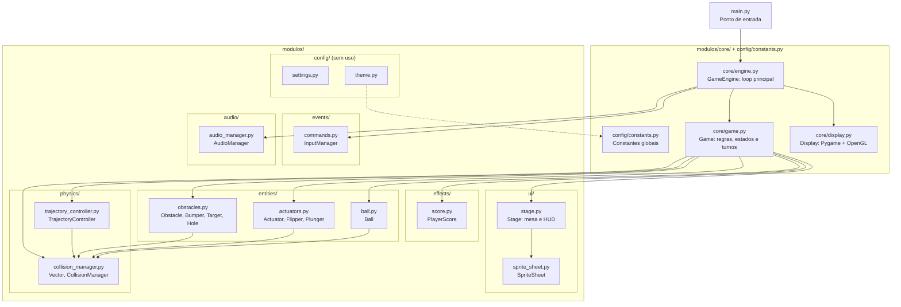
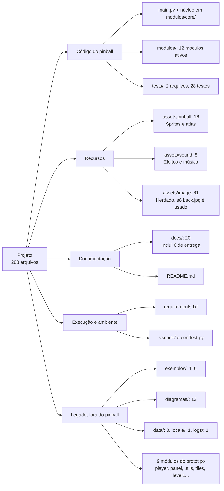

# PINBALL TAC III — PROJETO PYTHON / PYGAME / OPENGL

**Entregar e executar no Visual Studio Code, com Python, Pygame e PyOpenGL.** O arquivo principal é `main.py`; o jogo NÃO é HTML/JavaScript.

## COMEÇAR (Windows + VS Code)

1. Extraia o ZIP completo e abra a **pasta `Pinball_TACIII_Python`** no VS Code (`Arquivo → Abrir Pasta`).
2. Instale o Python 3.12 e a extensão **Python** no VS Code. Pylance e Python Debugger são opcionais e recomendadas.
3. No terminal PowerShell do VS Code, execute:

```powershell
py -3.12 -m venv .venv
.\.venv\Scripts\python.exe -m pip install -r requirements.txt
.\.venv\Scripts\python.exe -c "import pygame, OpenGL; print(pygame.version.ver, OpenGL.__version__)"
.\.venv\Scripts\python.exe main.py
```

4. No VS Code, `Ctrl+Shift+P → Python: Select Interpreter → .venv\Scripts\python.exe`. Para depurar, pressione **F5** e escolha **Pinball TAC III (Pygame + OpenGL)**.

## COMEÇAR (Linux / macOS)

Na raiz do projeto, com Python 3.12:

```bash
python3.12 -m venv .venv                 # só na primeira vez
source .venv/bin/activate                # ativa o ambiente
pip install -r requirements.txt pytest   # só na primeira vez
python main.py                           # inicia o jogo
python -m pytest -q tests                # testes automatizados
deactivate                               # sai do ambiente
```

No VS Code, selecione `.venv/bin/python` em `Python: Select Interpreter` (o `.vscode/settings.json` aponta para o caminho do Windows).

Na primeira instalação, é necessária internet para baixar os pacotes. **Não execute `modulos/core/game.py` isoladamente**; rode `main.py` na raiz.

**Documentação detalhada:** `docs/entrega/GUIA_VSCODE_WINDOWS.md` — instalação, problemas frequentes, seleção de ambiente. `docs/entrega/MAPA_DE_MODULOS_APRESENTACAO.md` — localização de sprites, áudio, física e regras; roteiro para explicar ao professor. `docs/entrega/GDD_COM_ANEXO_TECNICO.docx` — GDD com anexo explicativo. GDD original está preservado em `docs/entrega/GDD_original.docx`.

## Comandos

| Tecla | Ação |
|---|---|
| `1` / `2` no menu | Número de jogadores |
| `Enter` | Iniciar / nova partida |
| `A` / `←` | Flipper esquerdo |
| `D` / `→` | Flipper direito |
| `Espaço` (segurar/soltar) | Carga e lançamento |
| `P` / `Esc` | Pausa / retorno |
| `R` | Reiniciar |
| `M` | Mutar / voltar áudio |

## Origem e utilização dos arquivos visuais/sonoros

- Três pranchas originais recebidas: `assets/pinball/PINBALL1.png`, `PINBALL2.png`, `PINBALL3.png`.
- **Sprite sheet efetivamente carregada:** `assets/pinball/pinball_atlas.png` + coordenadas em `pinball_atlas.json`.
- **Código para os recortes em execução:** `modulos/ui/sprite_sheet.py` (`SpriteSheet`) e desenho em `modulos/ui/stage.py` (`Stage`).
- Áudio do jogo em `assets/sound/` (singular), gerenciado por `modulos/audio/audio_manager.py`; efeitos e trilha foram sintetizados como assets adicionais para RF11 e RF12.
- Módulos essenciais: `modulos/core/engine.py` (loop), `modulos/core/display.py` (Pygame/OpenGL), `modulos/events/`, `modulos/physics/`, `modulos/entities/`, `modulos/effects/`, `modulos/ui/`, `modulos/audio/`, `modulos/core/game.py` (regras/turnos).

## GDD: regras e limitações

A matriz de requisitos RF1–RF13 e RNF1–RNF5 está em `docs/entrega/MATRIZ_DE_CONFORMIDADE.md`. Parâmetros de jogabilidade (pontos, duração de bônus, 3 bolas/pessoa) foram definidos na implementação porque o GDD não determina seus valores.

**A renderização usa OpenGL por padrão.** A opção `python main.py --compat-pygame` existe exclusivamente como **diagnóstico da interface** se houver problema de OpenGL, não como substituição do requisito de utilizar OpenGL.

Os testes automatizados do pacote validam lógica e assets; **som, contexto gráfico e FPS real em Windows ainda precisam ser testados no PC**. Não alegamos comprovação de 30 FPS sem medição. Checklist: `docs/entrega/TESTE_MANUAL_WINDOWS.md`.

### Testes automatizados

```powershell
.\.venv\Scripts\python.exe -m pip install pytest
.\.venv\Scripts\python.exe -m pytest -q tests
```

### Diagramas

`docs/classes_game.png` e `docs/packages_game.png`; `python docs/generate.py` gera a partir dos módulos utilizando AST/Graphviz, com pyreverse como opção. O programa precisa do Graphviz `dot` para gerar PNG/SVG.

### Arquitetura de pastas

Na raiz fica apenas o ponto de entrada `main.py`; o núcleo (loop, regras, janela) está em `modulos/core/`, as constantes em `modulos/config/constants.py` e os demais módulos em `modulos/`.

```text
Pinball_TACIII_Python/
├── main.py                 # ponto de entrada (único .py de jogo na raiz)
├── modulos/
│   ├── core/               # engine.py (loop), game.py (regras/turnos), display.py (Pygame + OpenGL)
│   ├── audio/              # áudio
│   ├── config/             # constants.py, opções e tema
│   ├── effects/            # pontuação e bônus
│   ├── entities/           # bola, flippers, lançador e obstáculos
│   ├── events/             # entrada de teclado (commands.py)
│   ├── physics/            # colisões e trajetória
│   └── ui/                 # mesa, HUD e sprite sheet
├── assets/                 # sprites, sons e imagens
├── tests/                  # testes automatizados
├── docs/                   # documentação e diagramas do pinball
├── diagramas/              # diagramas do protótipo original
├── data/, locale/, logs/   # material herdado, sem uso no pinball
└── exemplos/               # exemplos de aula
```

### Resumo de arquivos e módulos

O projeto tem **288 arquivos**, e o pinball funciona com **17 módulos Python**, dos quais 15 estão conectados ao jogo. A versão completa deste resumo está em `docs/resumen_arquitectura.md`.

**Módulos e dependências**



`modulos/config/constants.py` também é usado por `engine`, `game`, `display`, `stage`, `score`, `ball` e `trajectory_controller`. Essas setas foram omitidas para manter o diagrama legível.

**Organização dos arquivos**



**Pontos a limpar**

- `modulos/config/` não está conectado: nenhum módulo ativo importa `settings.py` ou `theme.py`.
- O código legado teve os imports apontados para `modulos.config.constants`, `modulos.core.display` e `modulos.core.game`, mas ainda depende de constantes e objetos do protótipo de plataforma (ex.: `SIZE_PLAYER`, `TILE_SIZE`, `display`, `game`) que não existem no pinball. O pinball não o utiliza.

### Materiais legados

Não fazem parte do pinball: `exemplos/`, `diagramas/`, `data/`, `modulos/editor.py`, `modulos/utils.py`, `modulos/entities/player.py`, `modulos/entities/tiles.py`, `modulos/events/actions.py`, `modulos/events/io.py`, `modulos/ui/background.py`, `modulos/ui/level1.py` e `modulos/ui/panel.py`. As versões originais de `main.py` e dos arquivos de núcleo do protótipo (antes na raiz) continuam na branch `alvaro-star/migracao-arquitetura`, no commit "Registrar protótipo original antes da migração".
